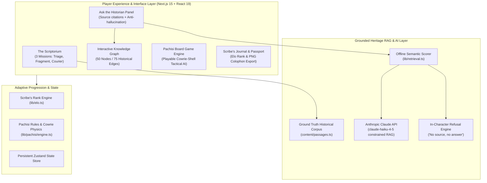

# BHARATVERSE — The Lost Library of Nalanda

[](https://nextjs.org/)
[](https://react.dev/)
[](https://www.typescriptlang.org/)
[](https://threejs.org/)
[](https://github.com/vasturiano/react-force-graph)
[](https://www.anthropic.com/)
[](#smart-india-hackathon)

> **An evidence-grounded digital heritage exploration and artifact preservation game.**  
> **Smart India Hackathon 2026** • Problem Statement **SIH26208 (Heritage & Culture)**

*It is 1202 CE. Bakhtiyar Khalji's raiders are three days from the Mahavihara of Nalanda. You are the last scribe on duty in the manuscript hall. What you save tonight — through **triage**, **deciphering fragmented palm leaves**, and **choosing courier escape routes** — is what future generations get to read. And when night falls, play a tactical match of ancient **Pachisi** against traveling merchants.*

---

## 🏛️ System Architecture & Experience Loop



---

## 🌟 Core Gameplay Pillars & Features

### 1. The Scriptorium (Manuscript Preservation Missions)
- **The Triage:** Inspect fragile palm-leaf manuscripts and decide which treatise (astronomy, medicine, logic, grammar) to rescue first based on civilizational uniqueness and rarity.
- **The Fragment:** Interactive deciphering puzzle reconstructing damaged Sanskrit Brahmi inscriptions.
- **The Courier:** Route planning challenge dispatching monastic runners along historic trade roads toward Tibet, Nepal, and Kanchi.

### 2. "Ask the Historian" & Live Knowledge Graph
- **Anti-Hallucination Mandate:** Every answer displayed explicitly cites its historical source (e.g., Xuanzang's travel records, *Tabaqat-i-Nasiri*, ASI excavation monographs).
- **In-Character Strict Refusal:** Questions outside the verified corpus are refused in-character (*"No primary source, no answer"*).
- **Synchronized Force-Directed Graph:** When the Historian answers, the exact nodes and causal relationships on the 50-node / 75-edge knowledge graph dynamically pulse and illuminate in real time.

### 3. Ancient Indian Pachisi Engine
- Authentic recreation of the historic cross-shaped race board with six cowrie shells, grace throws (*chakkis*), strategic pawn captures, and an intelligent two-level AI opponent with match chronicles.

### 4. Dual Operational Modes (Judge Demo vs. Live AI)
- **Demo Mode (Default):** Runs **100% offline with zero external network calls**, utilizing pre-compiled, source-cited historical response maps.
- **Live Mode:** Connects to Anthropic Claude via server route (`/api/historian`), strictly constrained by RAG over the Nalanda corpus.

---

## 🛠️ Technology Stack

| Domain | Technologies |
|---|---|
| **Framework** | Next.js 15.5.25 (App Router, Server Actions) |
| **Frontend Core** | React 19.0.0, TypeScript 5.7, Tailwind CSS 3.4 |
| **3D & VR Exploration** | Three.js 0.180, React Three Fiber (`@react-three/fiber`), React Three Drei, `@react-three/xr` (WebXR) |
| **Data Visualization** | `react-force-graph-2d` (Force-directed knowledge graph) |
| **State & Animation** | Zustand 5.0, Framer Motion 13.2 |
| **AI Integration** | Anthropic Claude SDK (`@anthropic-ai/sdk` 0.32) with local RAG fallbacks |

---

## 📂 Project Structure

```text
bharatverse-nalanda/
├── app/
│   ├── api/historian/         # Claude API RAG endpoint with source enforcement
│   ├── explore/               # Free-roam exploration routes
│   ├── games/                 # Minigames hub (Pachisi & archaeological puzzles)
│   ├── journal/               # Scribe's chronicle & colophon export
│   ├── judge/                 # Dedicated 5-minute SIH evaluation showcase
│   ├── lens/                  # Ancient Nalanda optical reconstruction lens
│   ├── map/                   # Ancient India geographic campaign progression
│   ├── nalanda/               # Core Mahavihara narrative level
│   ├── pachisi/               # Fullscreen Pachisi board game interface
│   ├── passport/              # Scribe's Rank and verified achievement stamps
│   ├── layout.tsx             # Root layout with Web Audio ambient synthesizer
│   └── page.tsx               # Entrance gateway and narrative prologue
├── components/
│   ├── campaign/              # Realm progression and stage stepper
│   ├── games/                 # Ancient game widgets
│   ├── graph/                 # Force-directed knowledge graph visualizer
│   ├── historian/             # "Ask the Historian" panel & citation inspector
│   ├── journal/               # Colophon recap renderer
│   ├── pachisi/               # Board, pawn animations, cowrie throw physics
│   └── scriptorium/           # Triage desks, manuscript viewers, fragment puzzles
├── content/
│   ├── passages.ts            # Ground truth historical corpus with source citations
│   ├── graph.ts               # Knowledge graph node and edge definitions
│   └── historianCanned.ts     # Offline verified question-answer pairs
├── docs/
│   ├── BHARATVERSE_MASTER_SPEC.md # Full product specification & game mechanics
│   ├── SOURCES.md             # Archaeological and historical references
│   └── SETUP_REQUIRED.md     # Installation and deployment reference
├── lib/
│   ├── elo.ts                 # Scribe's Rank rating and progression math
│   ├── retrieval.ts           # Semantic scoring and passage matching
│   └── pachisi/engine.ts      # Pachisi game rules, cowrie scoring, and AI bot
├── package.json               # Dependencies and scripts
└── next.config.mjs            # Next.js configuration
```

---

## 🚀 Getting Started

### Prerequisites
- **Node.js**: `v18.17+` or `v20+`
- **npm** or **pnpm**
- **Anthropic API Key**: *(Optional)* Required only for Live Mode Claude calls.

### 1. Clone & Install
```bash
git clone https://github.com/Swaraj0160/bharatverse-nalanda.git
cd bharatverse-nalanda
npm install
```

### 2. Environment Configuration
Copy the reference configuration:
```bash
cp .env.example .env.local
```
*(Leave blank for offline Demo Mode, or supply `ANTHROPIC_API_KEY` for live Claude generation).*

### 3. Launch Development Server
```bash
npm run dev
```
Navigate to [http://localhost:3000](http://localhost:3000).

### 4. Build for Production
```bash
npm run build
npm start
```

---

## 🏛️ Sourcing & Academic References

All narrative passages and artifact descriptions are cataloged in [`docs/SOURCES.md`](docs/SOURCES.md) and derived from:
- **Travel Records of Xuanzang:** *Great Tang Records on the Western Regions* (7th century CE).
- **Minhaj-i-Siraj:** *Tabaqat-i-Nasiri* (c. 1260 CE).
- **Archaeological Survey of India (ASI):** Excavation reports on Nalanda Mahavihara ruins (Site No. 1–11).
- **Ancient Board Game Rules:** Traditional Indian Pachisi / Chaupar rules and cowrie throw mathematics.

---

## 🤝 Contributing

Contributions to historical accuracy, 3D WebXR assets, and board game heuristics are welcome! See [`CONTRIBUTING.md`](CONTRIBUTING.md) for details.

---

## 👥 Authors & Hackathon Team

- **Architect & Developer:** **Swaraj Ingale** ([@Swaraj0160](https://github.com/Swaraj0160))
- **Hackathon:** Smart India Hackathon 2026 (Problem Statement SIH26208)
