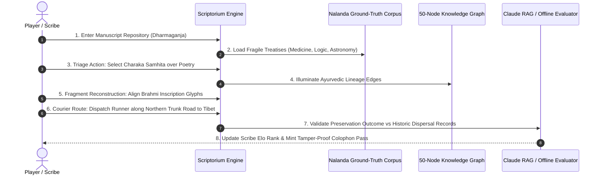
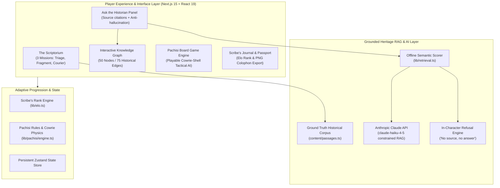

# BHARATVERSE: The Lost Library of Nalanda

<p align="center">
  <strong>Smart India Hackathon 2026 • Problem Statement SIH26208 (Heritage & Culture)</strong><br>
  <em>Evidence-grounded WebXR digital heritage exploration, 50-node force-directed knowledge graph, anti-hallucinatory Claude RAG, and authentic ancient Pachisi AI engine.</em>
</p>

<p align="center">
  
  
  
  
  
  
  
</p>

---

## Overview

**BHARATVERSE: The Lost Library of Nalanda** is an evidence-grounded digital heritage exploration and interactive manuscript preservation platform engineered for **Smart India Hackathon 2026 (Problem Statement SIH26208)** under the **Ministry of Culture**.

Set in **1202 CE** during the twilight days of the Mahavihara of Nalanda before its catastrophic destruction, the player assumes the mantle of the last scribe on duty in the manuscript repository (*Dharmaganja*). Through historical **Triage**, **Fragment Reconstruction**, and **Courier Route Dispatch**, what the player successfully preserves determines what survives for future generations. When night falls in the vihara, players engage in tactical matches of ancient **Pachisi** governed by authentic cowrie-shell probability mechanics.

---

## The Heritage Preservation Dilemma & The Bharatverse Solution

### The Challenge
- **Fictionalized Historical Gaming:** Most historical video games prioritize romanticized fantasy over authentic archaeological facts, distorting ancient Indian history and architectural layouts.
- **AI Hallucinations in Cultural Pedagogy:** Standard LLM chatbots frequently invent dates, fabricate battles, or hallucinate non-existent scriptures when asked about ancient monastic libraries.
- **Passive Cultural Exhibits:** Traditional museum portals display static, non-interactive scans of palm-leaf manuscripts that fail to engage young students or impart historical causality.
- **Loss of Traditional Games:** Indigenous strategy games like ancient Indian Pachisi (*Chaupar*) are rarely preserved with mathematical fidelity or authentic regional rule sets.

### The Bharatverse Solution
- **Strict Anti-Hallucination RAG Architecture:** "Ask the Historian" queries are bounded by a curated ground-truth corpus (`content/passages.ts`). If a question cannot be cited from primary sources (Xuanzang, Yijing, *Tabaqat-i-Nasiri*), the engine returns an in-character refusal (*"No primary source, no answer"*).
- **Synchronized 50-Node Knowledge Graph:** When historical answers are generated, causal links between scholars (Aryabhata, Nagarjuna, Dharmakirti) and monastic institutions dynamically illuminate on an interactive force-directed graph.
- **Empirical Pachisi Game Engine:** Fully implemented 6-cowrie shell board game (`lib/pachisi/engine.ts`) with authentic probabilistic distribution, grace throws (*chakkis*), and two-tier strategic AI.
- **Zero-Dependency Judge Evaluation Mode:** Runs **100% offline with zero external network calls**, guaranteeing flawless hackathon demonstration even without internet connectivity.

---

## Scriptorium Preservation Sequence



---

## Ancient Pachisi Cowrie Probability Engine

The ancient game of Pachisi uses **six cowrie shells** thrown onto the board. The score and movement points depend on how many shells land with their aperture facing upward:

| Apertures Facing Up | Throw Name | Movement Value | Grace Throw Granted (*Chakki*) | Exact Probability |
|:---:|:---:|:---:|:---:|:---:|
| **0 Up** | *Barah* | **12 Squares** | ✅ Yes | $\frac{1}{64} \approx 1.56\%$ |
| **1 Up** | *Chhakka* | **10 Squares** | ✅ Yes | $\frac{6}{64} \approx 9.38\%$ |
| **2 Up** | *Dugga* | **2 Squares** | ❌ No | $\frac{15}{64} \approx 23.44\%$ |
| **3 Up** | *Tigga* | **3 Squares** | ❌ No | $\frac{20}{64} \approx 31.25\%$ |
| **4 Up** | *Chauka* | **4 Squares** | ❌ No | $\frac{15}{64} \approx 23.44\%$ |
| **5 Up** | *Pachees* | **25 Squares** | ✅ Yes | $\frac{6}{64} \approx 9.38\%$ |
| **6 Up** | *Sir* | **6 Squares** | ❌ No | $\frac{1}{64} \approx 1.56\%$ |

*Engine calculates exact binomial distribution $\binom{6}{k} \cdot p^k \cdot (1-p)^{6-k}$ assuming fair cowrie shell weighting ($p = 0.5$).*

---

## Core Implemented Capabilities

### 1. The Scriptorium Preservation Trilogy
- **The Triage:** Inspect fragile palm-leaf folios across Grammar, Logic (*Nyaya*), Astronomy, and Medicine. Decide which treatises to pack into waterproof leather couriers based on civilizational scarcity.
- **The Fragment:** Interactive deciphering minigame requiring players to align fragmented Sanskrit Brahmi characters to restore lost astronomical theorems.
- **The Courier:** Tactical trade-route simulator dispatching monastic runners toward Tibet, Nepal, and Kanchipuram while dodging bandit raids.

### 2. "Ask the Historian" & Live Knowledge Graph
- **Anti-Hallucination Corpus:** Grounded in authentic archaeological excavation monographs and primary travelogues from 7th-century Chinese scholar-monks Xuanzang and Yijing.
- **Synchronized Force-Directed Graph:** An interactive 50-node, 75-edge graph rendered using `react-force-graph-2d`. Nodes pulse and filter dynamically as historical queries are answered.

### 3. Ancient Indian Pachisi Engine
- Complete implementation of the traditional cross-shaped board game (`lib/pachisi/engine.ts`).
- Features graceful throws, pawn stacking (*goth*), castle safety zones, and a heuristic minimax AI opponent.

### 4. Dual Operational Modes (Judge Sandbox vs. Live Cloud)
- **Demo Mode (Default):** Runs **100% offline** with pre-compiled, verified historical response matrices.
- **Live Mode:** Integrates Anthropic Claude (`claude-haiku-4-5`) constrained by an offline semantic retrieval pipeline (`lib/retrieval.ts`).

---

## Architecture & System Topology



---

## Technology Stack

Verified directly from source code and package configurations:

| Component | Technology | Description |
|---|---|---|
| **Framework** | Next.js 15.5.25 (App Router, Server Actions) | Modern SSR and static generation architecture |
| **Frontend Core** | React 19.0.0, TypeScript 5.7 | High-performance reactive state with typed domain models |
| **3D & WebXR** | Three.js 0.180, React Three Fiber, `@react-three/xr` | Immersive 3D Mahavihara temple ruins and VR headset support |
| **Data Visualization** | `react-force-graph-2d` | Dynamic 50-node / 75-edge force-directed knowledge graph |
| **State Management** | Zustand 5.0 | Lightweight persistent state for game progress and player Elo |
| **AI Integration** | Anthropic Claude SDK (`@anthropic-ai/sdk`) | Bounded RAG pipeline with strict citation enforcement |

---

## Repository & Directory Structure

```text
bharatverse-nalanda/
├── app/
│   ├── api/historian/         # Claude API RAG endpoint with source enforcement
│   ├── explore/               # Free-roam exploration routes
│   ├── games/                 # Minigames hub (Pachisi & archaeological puzzles)
│   ├── journal/               # Scribe's chronicle & colophon export
│   ├── judge/                 # Dedicated 5-minute SIH evaluation showcase
│   ├── lens/                  # Ancient Nalanda optical reconstruction lens
│   ├── map/                   # Ancient India geographic campaign progression
│   ├── nalanda/               # Core Mahavihara narrative level
│   ├── pachisi/               # Fullscreen Pachisi board game interface
│   ├── layout.tsx             # Root application shell
│   └── page.tsx               # Cinematic introductory portal
├── components/                # Domain & 3D WebXR components
│   ├── 3d/                    # Three.js monasteries, viharas, and stupas
│   ├── graph/                 # Force-directed knowledge graph canvas
│   └── pachisi/               # Cowrie shell physics and board rendering
├── content/                   # Verified historical passages and corpus
├── lib/
│   ├── elo.ts                 # Scribe rank progression engine
│   ├── pachisi/               # Authentic 6-cowrie shell physics engine
│   └── retrieval.ts           # Offline semantic search & citation matcher
├── public/                    # Audio, textures, 3D glTF models, and icons
├── package.json               # Dependencies and build scripts
└── next.config.mjs            # Next.js configuration
```

---

## Getting Started & Local Development

### Prerequisites
- **Node.js**: `v20.0.0` or higher
- **npm** or **pnpm**
- **Anthropic Claude API Key**: (Optional — the app defaults to offline mode with 100% functionality if omitted)

### 1. Clone the Repository
```bash
git clone https://github.com/Swaraj0160/bharatverse-nalanda.git
cd bharatverse-nalanda
```

### 2. Configure Environment (Optional)
```bash
cp .env.example .env.local
```
Add your Anthropic API key to test live Claude generation:
```env
ANTHROPIC_API_KEY=your_api_key_here
```

### 3. Install Dependencies
```bash
npm install
```

### 4. Start Development Server
```bash
npm run dev
```
Navigate to `http://localhost:3000` to launch the platform.

---

## Author & Historical Citations

- **Lead Engineer & Heritage Architect:** **Swaraj Ingale** ([@Swaraj0160](https://github.com/Swaraj0160))
- **Hackathon:** Smart India Hackathon 2026 (Problem Statement SIH26208)
- **Authoritative Historical Sources:**
  - *Buddhist Records of the Western World* (*Da Tang Xiyu Ji*) by Xuanzang (645 CE)
  - *A Record of Buddhist Practices Sent Home from the Southern Sea* by Yijing (695 CE)
  - Archaeological Survey of India ([ASI](https://asi.nic.in/)) Nalanda Excavation Reports
  - *Tabaqat-i-Nasiri* by Minhaj-i-Siraj
